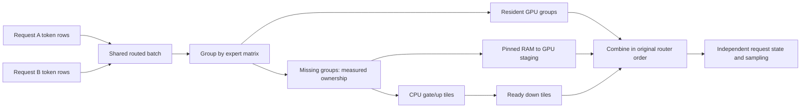

# Native CPU/GPU batch execution experiment

This local experiment builds on the stable two-slot verifier and the separate
native two-slot MTP experiment. It changes expert scheduling and CPU task
dependencies. Original safetensors, projection weights, KV format, router
weights, forward kernels, sampling and session state formats stay the same.

## Execution

The existing verifier already collects tokens from both requests and groups
them by expert. One expert group owns all the routed rows that share its weight
matrix. Resident groups execute on the GPU. Missing groups execute on the CPU
or use the existing pinned-RAM-to-GPU staging path. Router row indices remain
unchanged, so combining the outputs applies each router weight exactly once.
Within a group the existing kernels reuse weights across its token rows. Groups
using different expert matrices remain separate grouped operations. This is a
logical shared batch, not a single hardware GEMM spanning CPU RAM and VRAM.



Four independently selectable changes extend that execution:

- `STRATA_NATIVE_READY_QUEUE=1`: the CPU publishes gate/up row tiles once. The
  last finished tile of an expert publishes that expert's down tiles to a ready
  queue. Workers take ready down work or remaining gate/up work; they never hold
  a down task while waiting for its inputs. The original FP32 intermediate is
  read directly, removing the global gate/up barrier and intermediate copy.
  Tile counts account for each expert's actual token count. All dots and
  reductions still use the existing CPU kernels.
- `STRATA_UNIFIED_EXPERT_PLAN=1`: CPU host spans and GPU device stamps train
  separate nonnegative cost fits for each window width. Features distinguish
  expert groups (weight reads) from routed token entries (FMA work), including
  GPU resident and PCIe work. A bounded subset search assigns complete missing
  groups to CPU or GPU to minimize predicted completion time. A shared expert
  is never split into one job per request. Staging capacity is enforced.
- `STRATA_UNIFIED_FETCH_OVERLAP=1`: after the GPU snapshots the plan, a captured
  side branch stages PCIe experts while the main branch computes resident
  experts. The branches join before consuming the staged weights. It reuses
  the existing copy and expert kernels. DMA/direct modes and GPU stage profiling
  keep their old ordering.
- `STRATA_NATIVE_WARM_AHEAD=1`: after current-layer CPU experts finish, workers
  read the previous window's next-layer CPU expert blobs into CPU caches while
  the host waits for the GPU router. The next dispatch cancels and joins this
  work before publishing compute jobs. Cancellation is checked every 1 KiB;
  late sleepers use the pool's existing epoch-tagged claims. Descriptors are
  copied into the pool. Only immutable pointers already obtained for real CPU
  jobs are used, and experts now resident in VRAM are filtered out. It never
  calls the expert source for a prediction, and no warming crosses the last
  layer of a window. Unsupported sources keep the old path.

`STRATA_UNIFIED_EXPERT_BATCH=1` requests the ready queue, ownership planner and
fetch overlap. An explicit individual setting overrides the master setting.
All settings default to off. The queue
requires original FP32 NVFP4 expert activations and the supported geometry;
other CPU formats keep their old path. The measured planner additionally
requires single-GPU native canonical FP32 decode with FP4 activation
quantization off. Unsupported configurations log why the planner stays off.
Cache warming has its own switch and is not enabled by the master setting.
It spends host-memory bandwidth and can lose performance when predictions miss
or when GPU staging competes for the same RAM. It must be measured separately.

During cost-model warmup the old ownership policy is used. Each width needs at
least 64 samples and variation in the PCIe group count. A prediction below a
1% improvement keeps the existing split. No decode-to-SSD expert reads are
introduced. The plan still publishes GPU work before running the CPU share.
The existing hot-expert tier continues replacing resident experts between
windows; this planner does not replace its ranking or eviction policy.

The planner is an experimental online estimate, not a guarantee of an optimal
hardware split. CPU and GPU share host memory bandwidth when staging weights,
and an unusually slow window can affect the fit. End-to-end measurements decide
whether to use it. No route pruning or extra quantization is permitted by this
experiment. `STRATA_ROUTE_TAIL_SKIP=0` is retained in its test profiles.

## Verification tools

```powershell
./tools/build_safetensors_engine.ps1 -Jobs 8 -OutputName strata-unified-expert-final -Targets @('strata','native_ready_queue_test','unified_expert_plan_test')
$env:STRATA_NVFP4_F32_CANONICAL='1'
$env:STRATA_NVFP4_F32_UNROLL='1'
./build-native-engine/native_ready_queue_test.exe
./build-native-engine/unified_expert_plan_test.exe
.venv-native/Scripts/python.exe tools/native_unified_batch_benchmark.py --config config/native/rtx5090-262k-parallel-mtp.json --exe build-native-engine/strata-unified-expert-final.exe --output bench/results/local-unified-check --freeze
```

The CPU test compares every output byte against the old two-phase CPU pool,
including mixed expert batch widths, sleeping workers, different task counts,
host participation and more experts than intermediate buffers. It also checks
immediate warm cancellation, replacement, partial cache lines and joining at
pool destruction. The planner
test recovers synthetic measured costs and compares its group assignments
against exhaustive subset enumeration, including the 128-entry boundary.

The private benchmark uses the same executable for selectable off / queue /
planner / fetch / warming combinations and repeated off controls, two complete
warmups per arm and three measured rounds. The
optional frozen-cache mode trains one private ranking, uses the same cache
capacity and disables promotion in every measured arm. It checks exact output
IDs, real overlapping generation, normal engine exit and zero post-residency
expert/MTP source reads. It never starts HTTP or edits a desktop profile.
An explicit `--expert-slots` also fixes capacity without disabling promotion.
The existing prefill-first startup requires automatic capacity, so controlled
manual-capacity tests use `STRATA_NATIVE_PREFILL_FIRST=0` in every arm while
retaining dedicated prefill workspace. Real launch-profile acceptance keeps
automatic capacity and prefill-first enabled. Rankings are hashed and checked
between arms, and different cache capacities reject the comparison.
`--mtp` repeats the experiment with spec 3 and confidence 0.5. A frozen cache
defaults to 3800 requested slots for MTP and 5000 for target-only execution;
`--expert-slots` overrides this. The target-only capacity plus draft KV/workspace
does not fit this 32GB card. Timings include
admission/cache restore and separately report the overlapping decode interval.

Real-model functional acceptance uses `tools/native_concurrency_acceptance.py`
with a private config containing the feature flags. It checks seeded sampling,
penalties, cancellation, continuation, cache reuse, caps/EOS and long contexts.
MTP acceptance also checks simultaneous proposals, confidence gating and prefix
commit. Finite byte/token comparisons are not a broad model-quality evaluation.
Only Windows CUDA / RTX 5090 / Ryzen 9950X3D is the target of this experiment;
HIP, SYCL, other GPUs and more than two request slots require separate work.

Startup `INFO unified_expert_plan=... native_ready_queue=... expert_fetch_overlap=... cpu_warm_ahead=...` reports the active
features. Exit diagnostics report queue batches and planner samples/decisions,
including decisions that actually changed group ownership. GPU stamps measure
the expert span rather than total GPU utilization. CPU/GPU timers must not be
added and advertised as utilization percentages.
Warming `RAM_bytes` counts logical cache-line spans touched. It is not a
physical DRAM-traffic or cache-hit counter.

## Separate launch profile

`START-NATIVE-262K-UNIFIED-EXPERIMENT.bat` selects
`config/native/rtx5090-262k-unified-experiment.json`. It retains two request slots,
262144 configured context, 4096 dedicated prefill workspace, INT8 KV, vision,
full routed experts, sampling defaults and the existing adaptive hot tier. MTP
is off in this profile. CPU ready scheduling and cache warming are on; measured
ownership and fetch overlap remain available as separate experiments. The
launcher uses localhost port 8880. Existing desktop launchers and profiles are
not changed by this experiment.

`START-NATIVE-262K-UNIFIED-MTP-EXPERIMENT.bat` selects the separate
`rtx5090-262k-unified-mtp-experiment.json` profile with the same two CPU changes
and dual native MTP (`--spec 3 --spec-min-p 0.5`, no forced minimum drafts).
It retains the MTP experiment's safe slot-state path rather than requesting
independent target KV/device migration while draft state is loaded. This is
an optional comparison entry, and does not edit the existing MTP desktop entry.

Measured rates, exact binary/profile hashes and acceptance scope are recorded
under `bench/results/2026-10-11-unified-batch/`. No performance default should be
changed from this implementation alone. Earlier small positive differences
did not reproduce consistently: the restored-source queue/cache-warming repeat
regressed. These profiles are optional comparison entries; stable acceleration
has not been demonstrated, so the deployed launchers remain the daily path.
